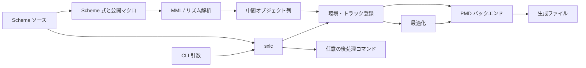

# sxmml の現行構成と設計

この文書は sxmml を保守・改修する開発者に、構成と変更時の調査先を示す。動作環境は Gauche 0.9.15 である。個々のクラス・手続き・マクロは[内部リファレンス](internal-reference/index.adoc)から名前で引ける。利用者が観測する構文・出力・制約は[外部動作仕様](behavior-spec.md)、製品の目的と責任範囲は[製品概要](product-overview.md)を参照する。

## システム境界

入力は `sxlc` の引数と、Gauche が評価する Scheme ソースファイルである。ソースには MML 文字列を作る式、トラック・音色・メタデータの定義、モード指定などを記せる。現在の出力は CP932 符号化の PMD 向け MML ファイルである（実験的な機能として、PMD のバイナリも生成できる）。

この図の後処理は `-c` 指定時だけ実行される。生成先と表示名の既知の差は[外部動作仕様](behavior-spec.md#要求との対応と既知の差)を参照する。矢印はデータ・制御の関係を表す。

## モジュールと責務

| 箇所 | 責務 | 主な入出力・依存 |
| --- | --- | --- |
| [`sxlc.in`](../sxlc.in) | 引数解析、モード設定、ソースの `load`、最適化水準の設定、バックエンド呼び出し、情報表示、任意の後処理 | `sxmml` と列挙した `sxmml.backend.*` を使用。ソースファイル・生成先・プロセスを扱う |
| [`sxmml.scm`](../sxmml.scm) | 基本モジュール群を `extend` して `sxmml` を構成 | PMD バックエンド（`backend/pmd.scm`・`backend/pmd-binary.scm`）は継承対象に含まれない |
| [`sxmml/classes.scm`](../sxmml/classes.scm) | 環境、トラック文脈、解析結果、最適化文脈、音色等のクラスと、エラーの種類（`<sxmml-error>`・`<sxmml-form-error>`） | 他モジュールが共有するオブジェクトの形を定義 |
| [`sxmml/environment.scm`](../sxmml/environment.scm) | 環境・ファイル名のパラメータ、トラック・メタデータ・LFO・エンベロープの登録と参照 | 環境内の表とトラック文脈を更新 |
| [`sxmml/mml.scm`](../sxmml/mml.scm) | 通常 MML とリズム MML の PEG パーサー、コマンドから中間オブジェクトへの変換 | トラック文脈を参照・更新し、解析結果を作る |
| [`sxmml/compiler.scm`](../sxmml/compiler.scm) | Scheme 式の結果を MML 文字列にし、パーサーを起動して解析結果を登録 | `mml` / `rhythm` マクロ、文字列、トラック文脈、中間オブジェクト列 |
| [`sxmml/processor.scm`](../sxmml/processor.scm) | `mml-repeat`、`mml-echo`、`mml-delay` による解析結果の加工・登録 | コンパイラと環境を使用。書式と既知の差は[公開マクロ](sxmml-reference-manual.adoc)を参照 |
| [`sxmml/voice.scm`](../sxmml/voice.scm) | FM 音色の定義データを整形し環境に登録 | `define-opn-voice` と環境内の音色表 |
| [`sxmml/optimizer.scm`](../sxmml/optimizer.scm) | トラックごとの登録済みオブジェクトを列に整え、指定水準に応じてまとめる・省く | `sxmml-optimize-tree` は列を返し、トラックの合計 tick 等も設定。水準 `3` 以上は `sxmml.repeat-tree` を使う |
| [`sxmml/repeat-tree.scm`](../sxmml/repeat-tree.scm) | 同値比較できる要素の列を、展開すると元の列になる最小費用の局所反復木に圧縮する | sxmml のクラスに依存しない。`sxmml.optimizer` が使用。`sxmml` の継承対象に含まれない |
| [`sxmml/backend/pmd.scm`](../sxmml/backend/pmd.scm) | PMD モードの登録、トラック列の変換、メタデータ・音色・リズム・MML の出力 | 最適化結果と環境から CP932 のファイルを生成 |
| [`sxmml/backend/pmd-binary.scm`](../sxmml/backend/pmd-binary.scm) | PMD バイナリモード（実験的）の登録、トラック列から PMD の命令列・音色表・メタ情報への変換 | 最適化結果と環境から `.m` を生成。生成物が MC.EXE の出力と同じであることは保証しない |
| [`sxmml/util.scm`](../sxmml/util.scm) | BPM から PMD 向け Timer-B 値への計算 | バックエンドが使用 |
| [`sxmml/form.scm`](../sxmml/form.scm) | 定義のマクロの誤りに、フォームの開始位置（ファイルと行）を付けて投げる | `sxmml.voice`・`sxmml.environment` が使用。`sxmml` の継承対象に含まれない |

`sxmml.scm` の `extend` は Gauche のモジュール継承であり、各モジュールでの `use` はそのモジュールが他モジュールの束縛を利用するための宣言である。継承・公開名の仕様は [Gauche 0.9.15 Users’ Reference, 4.13.4–4.13.5](https://practical-scheme.net/vault/Gauche-0.9.15-refe.pdf)に従う。MML 記述者向けの操作は[公開リファレンス](sxmml-reference-manual.adoc)、開発者向けのクラス・手続きは[内部リファレンス](internal-reference/index.adoc)に記す。

## 処理とデータの流れ

1. `sxlc.in` の `main` は引数から入力パス、モード、最適化水準を取得する。指定されたモード手続きの呼び出し後にソースを `load` し、環境の `backend` を呼ぶ。`-m` を指定した場合は `sxmml-mode-fixed` を真にしてソースを読み込むため、ソース中の `sxmml-mode` は無視され、CLI のモードが有効になる。
2. `sxmml/backend/pmd.scm` の `pmd`・`pmd3` は、環境の `backend` と `mode`、既定の出力先の拡張子（`output-extension` slot に `"mml"`）を設定し、トラックを登録する。`environment.scm` の `sxmml-environment` などのパラメータと環境オブジェクトに変換中の状態が置かれる。
3. `compiler.scm` の `mml` / `rhythm` は Scheme 式の結果を `write-tree` で文字列化する。`mml.scm` のパーサーが通常 MML またはリズム MML を中間オブジェクト列に変換し、トラック文脈の音長・音高・tick 等も更新する。結果はトラックの `compiled-data` に登録される。`processor.scm` の `mml-repeat`・`mml-echo`・`mml-delay` はこの登録経路を利用し、オブジェクト列を加工する。
4. `backend/pmd.scm` の通常トラック処理 `%track-output` とリズムトラック処理 `%pmd-rhythm-track-output` は、それぞれ `optimizer.scm` の `sxmml-optimize-tree` を呼ぶ。水準 `0` は登録列を平坦化し、水準 `1` は近接する設定オブジェクトをまとめ、水準 `2` は追加の状態比較と連続休符の結合を行う。水準 `3` 以上はさらに、`repeat-tree.scm` の圧縮器で命令列を反復（`[ ]`・`[ : ]`）に圧縮する。水準 `3` は既存のリピートをひとまとめにし、水準 `4` 以上は小さい既存のリピートを展開してから圧縮する。これらはコンパイル後のオブジェクト数を減らす処理であり、最終文字列長を評価基準にはしない。水準別の比較は[検証方針](verification.md#r-03-オブジェクト数の削減)を参照する。
5. PMD バックエンドはオブジェクト型ごとの出力手続きを呼び、メタデータ・音色・トラックの文字列を一時ファイルに CP932 で書いて生成先へ移す（`backend/pmd.scm` の `%pmd-source-output`）。その後 CLI がトラック情報を表示し、`-c` があれば外部コマンドを実行する（`sxlc.in` の `main`）。`main` はオプション解析・モード選択、変換、後処理の段階ごとにエラーを捕捉し、使用法の誤りを終了値 2、変換の失敗を 1、後処理の失敗を 3 として終了する。

PMD バイナリモード（`backend/pmd-binary.scm`、実験的）も同じ流れをたどる。モード手続き `pmd-binary`・`pmd4-binary`・`pmd3-binary` が `output-extension` に `"m"` を設定し、生成手続きはトラックごとに `sxmml-optimize-tree` を呼んで、オブジェクト型ごとに PMD の命令をバイト列へ書き込む。全トラックの後に音色表と（PMD4 向けでは）メタ情報を置き、ヘッダに各トラックの位置を記して、一時ファイルを生成先へ移す（`%pmd-binary-output`）。

`classes.scm` は `<sxmml-environment>` と `<sxmml-mml-context>` などのデータ構造を定義する。`<sxmml-environment>` は解像度・各定義表・モード・バックエンドを持ち、各 `<sxmml-mml-context>` はトラック名、解析時の状態、登録列、tick 統計を持つ。解析結果の音符・休符は `value` と `ticks` を持ち、その他の slot はオブジェクト型ごとに異なる。Gauche のクラスと slot 操作は [Users’ Reference, 7 Object system](https://practical-scheme.net/vault/Gauche-0.9.15-refe.pdf)に従う。単一オブジェクトの slot 変更でトラック文脈の値も同期するとは限らない。slot を直接編集する場合は、関連する文脈値も更新する必要がある。文脈の構造は[トラック文脈](internal-reference/classes.adoc#ref-classes-class-sxmml-mml-context)を参照する。

## 公開境界と拡張点

* Scheme ソース向けの入口は `sxmml` モジュールに継承された `mml`、`rhythm`、定義・加工マクロと、別モジュールの PMD モード手続きである。マクロの実際の書式・制約を確認する入口は `compiler.scm`、`processor.scm`、`environment.scm`、`voice.scm`。個々の定義は[内部リファレンス](internal-reference/index.adoc)を参照する。
* バックエンドの接続点は、モード手続きが環境の `backend` slot に生成手続きを置き、CLI がそれを呼ぶ箇所である（`backend/pmd.scm` の `pmd-source`、`backend/pmd-binary.scm` の `pmd-binary` と `sxlc.in` の `main`）。`sxlc.in` の `%backend-list-output` は `sxmml.backend.*` を列挙し、`use-backend` が読み込む。 モード手続きは既定の出力先の拡張子を環境の `output-extension` slot に設定する。出力先の決定と、出力先が入力ファイルと同じでないかの検査は `sxlc.in` の `%output-file-resolve` が生成の前に行うため、バックエンドはこれらを扱わない。
* MML パーサーのコマンド登録は `mml.scm` の通常・リズム別の表、生成時の型別処理は `backend/pmd.scm` と `backend/pmd-binary.scm`（`%pmd-track-u8vector-set!`）の分岐にある。新しいコマンドの影響を調べる際には、オブジェクト型、解析、加工・最適化、生成の対応を追う。

## 外部依存と信頼境界

Scheme ソースは `load` で Gauche のコードとして実行される（`sxlc.in` の `main`）。入力を単なる MML データとして隔離する仕組みはこの入口にはない。変換作業では入力元を信頼できるかを判断する必要がある。Gauche の `load` は [Users’ Reference, 6.22.1 Loading Scheme file](https://practical-scheme.net/vault/Gauche-0.9.15-refe.pdf)を参照する。`-m` は受け取った名前を `eval` で解決し、`-c` は外部プロセスを起動する（`sxlc.in` の `main`）。バックエンド列挙は実行環境で見つかる `sxmml.backend.*` に依存する。これらの入口は実行環境の権限・インストール状態に影響される。

生成時は `backend/pmd.scm` の `%pmd-source-output` が Gauche の文字コード変換と一時ファイル・リネームを使う。利用する Gauche の機能は [Gauche 0.9.15 Users’ Reference の 9.5 Character code conversion、12.40 parser.peg、12.80 Lazy text construction、9.25 Parsing command-line options、High-level process interface](https://practical-scheme.net/vault/Gauche-0.9.15-refe.pdf)を参照する。

## 代表的な変更時の調査先

以下の表を変更影響の調査に使う。要求とテストの対応、未検証部分は[検証方針](verification.md)を参照する。

| 変更の例 | 最初に追う箇所 | 影響を確認する箇所・観測結果 |
| --- | --- | --- |
| 通常・リズム MML の構文、音長 | `mml.scm` のパーサーと tick 更新、`classes.scm` の文脈 | `compiler.scm` の解析・登録、`optimizer.scm` の列、`backend/pmd.scm` の生成結果。通常・リズム双方の境界入力を確認 |
| Scheme からのオブジェクト加工 | `processor.scm` のマクロと変換関数、`compiler.scm` の登録 | トラックの `compiled-data` と `current-ticks`、最適化前後の列、生成結果。`mml-repeat` 等の既知の差も参照 |
| 最適化条件 | `optimizer.scm` の各水準と状態管理 | トラックの合計 tick、最適化前後の列、PMD 生成結果。[Q-01 の比較方法](verification.md#q-01-音楽的な意味の保持)を使う |
| モード指定・生成先 | `sxlc.in` の引数・読み込み順・出力先の決定（`%output-file-resolve`、`%output-file-check`）、`<sxmml-environment>` の `output`・`output-extension` slot、`backend/pmd.scm` のモード手続き | CLI 表示、実際の生成パス、`-c` に渡す引数が一致すること |
| PMD 向け出力 | `backend/pmd.scm` のメタデータ・音色・型別出力 | CP932 のファイル内容、出力パス、代表トラックとリズム |

## 制約

* `environment.scm` の `sxmml-track-clear!` はトラック表全体を消去する。引数は取らない。
* `voice.scm` の `%4op-voice-shape` は `DT2`・`SEG` を含む値列を作り、`classes.scm` の `<sxmml-opmn-voice>` を継承する音色クラスがこの値列を保持する。`backend/pmd.scm` の `%pmd-source-voice-output` は両値を使用しない。`DT2` は OPN にないパラメータ、`SEG` はハードウェアにあるが PMD の音色パラメータにない SSG-EG に関する値であり、この未使用はバックエンドの対応範囲による。全ての共通音色パラメータが各バックエンドの生成物に現れるとは限らない。

既知の不具合・未実装・検証不足・仕様確認待ちは [課題一覧（GitHub の issue）](https://github.com/sayzbrdg/sxmml/issues)を参照する。

## 技術資料

公開名は[内部リファレンス](internal-reference/index.adoc)、要求との対応と未検証部分は[検証方針](verification.md)を参照する。Gauche のモジュール継承、マクロ、オブジェクト、パラメータ、PEG、文字列生成、ファイル読み込み・文字コード変換・CLI・プロセスの仕様は [Gauche 0.9.15 Users’ Reference](https://practical-scheme.net/vault/Gauche-0.9.15-refe.pdf)に従う。
